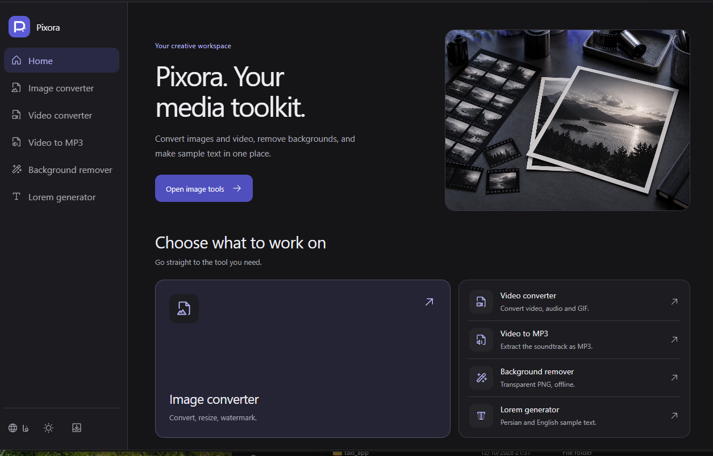

<div align="center">


# Pixora

**A private, offline image and video conversion studio**

Pixora runs entirely on your machine. No uploads, no cloud processing — your files never leave your computer.

[](https://t.me/farzin_the_tech_guy)
[](https://t.me/feri_ns83)
[](https://github.com/FarzinNs83/Pixora-Tool)

</div>

<p align="center">
  
</p>

---

## Features

- **Image Conversion** — Convert between PNG, JPEG, WebP, AVIF, GIF, BMP, TIFF, and more
- **Video Conversion** — Convert to MP4, WebM, MOV, MKV, GIF, MP3, and WAV via native FFmpeg
- **Background Removal** — AI-powered background removal using ONNX Runtime (runs fully offline)
- **Video Trimming** — Cut videos with precise start/end timestamps
- **Watermarking** — Overlay a custom image watermark with configurable position and opacity
- **Lorem Ipsum Generator** — Generate placeholder text with custom paragraph/word counts
- **Video to MP3** — Extract the soundtrack of any video as MP3
- **Bilingual UI** — Full English and Persian interface support
- **System tray** — Closing the window keeps Pixora running in the Windows tray; use the tray menu to reopen or quit
- **Cross-platform** — Windows, macOS, and Linux

---

## Requirements

- **Flutter SDK** 3.11+
- **FFmpeg** — bundled alongside the app binary or available on PATH (required for video conversion)
- **Microsoft Edge WebView2 Runtime** — Windows only (usually pre-installed on Windows 10/11)

---

## Getting Started

```bash
# Clone the repository
git clone https://github.com/FarzinNs83/Pixora-Tool.git
cd Pixora-Tool

# Install Flutter dependencies
flutter pub get

# Run on desktop
flutter run -d windows   # Windows
flutter run -d macos     # macOS
flutter run -d linux     # Linux
```

### Install on Windows

Download `Pixora-Setup-<version>-x64.exe` from the [Releases](https://github.com/FarzinNs83/Pixora-Tool/releases) page and run it. No administrator rights are required.

### Build a release

```bash
flutter build windows --release
flutter build macos   --release
flutter build linux   --release
```

### Build the Windows installer

Requires [Inno Setup 6](https://jrsoftware.org/isinfo.php). After `flutter build windows --release`:

```bash
"C:\Program Files (x86)\Inno Setup 6\ISCC.exe" installer\pixora.iss
```

The installer is written to `artifacts/installer/`. Place `ffmpeg.exe` next to `pixora.exe` in the release folder before compiling to bundle native video conversion.

---

## How It Works

Pixora embeds a local HTTP server inside the Flutter shell. At startup it binds to a user-chosen localhost port and serves a Vite/React web app from the bundled `website/dist/` assets. The Flutter window hosts a native WebView (WebView2 on Windows, `desktop_webview_window` on macOS/Linux) that points to this local server. All conversion work happens either in the browser via WebAssembly (image processing, FFmpeg-WASM, ONNX background removal) or via a native FFmpeg process managed by the Dart layer.

```
┌─────────────────────────────────────────┐
│  Flutter Shell                          │
│  ┌──────────────┐  ┌──────────────────┐ │
│  │  Native      │  │  Local HTTP      │ │
│  │  WebView     │◄─│  Server :port    │ │
│  │  (WebView2)  │  │  (Dart shelf)    │ │
│  └──────┬───────┘  └────────┬─────────┘ │
│         │ postMessage        │ /api/     │
│         ▼                   ▼           │
│  ┌──────────────────────────────────┐   │
│  │  React Web App (website/dist)    │   │
│  │  • Image engine (WASM)           │   │
│  │  • Video engine (FFmpeg-WASM /   │   │
│  │    native FFmpeg via HTTP API)   │   │
│  │  • AI background removal (ONNX)  │   │
│  └──────────────────────────────────┘   │
└─────────────────────────────────────────┘
```

---

## Project & Support

| | |
|---|---|
| **GitHub** | [github.com/FarzinNs83/Pixora-Tool](https://github.com/FarzinNs83/Pixora-Tool) |
| **Telegram Channel** | [t.me/farzin_the_tech_guy](https://t.me/farzin_the_tech_guy) |
| **Telegram Support** | [t.me/feri_ns83](https://t.me/feri_ns83) |

---

## License

This project is private. All rights reserved.
